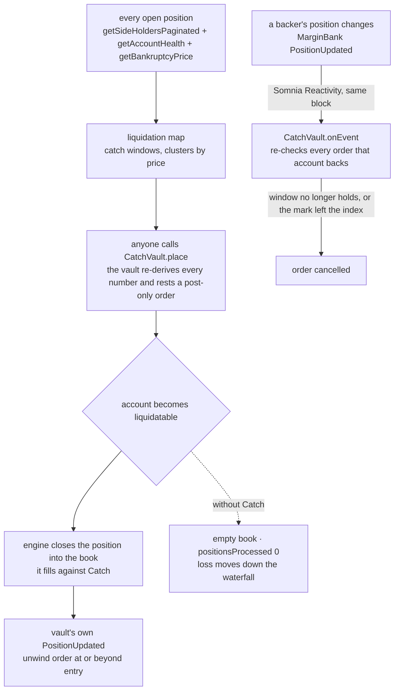

<div align="center">

# CATCH

### A buyer waiting where dreamDEX liquidations land. Resting liquidity at the prices positions will be force-closed, re-checked by the chain in the same block.

[](#live-status)
[](#live-status)
[](#invariants)
[](#invariants)
[](#the-engine)


[](https://catch-backstop.vercel.app) [](#run-it) [](#the-catch-loop-step-by-step) [](#whats-real-vs-pending)

</div>

On dreamDEX, a liquidation does not go to a private liquidator first. The engine cancels the account's resting orders and then closes the position **into the public order book**, limit-priced at most its maximum liquidation spread from the mark. Only if that fails does it reach a backstop bidder, then the insurance fund, then auto-deleveraging of profitable traders. The book is the first line of defence, and on a young venue it is often empty. Catch is a vault that stands in the book at the prices where liquidations will land, and drops each order the moment the positions behind it change.

```
every open position's liquidation price   →   a post-only order inside the engine's close window   →   the liquidation has a buyer
```

No admin can move depositor funds, no order rests where a liquidation cannot reach it, and no exposure is taken beyond caps fixed at deploy.

**Who it's for.** Depositors who want their USDso to earn from forced flow instead of sitting idle, with every rule enforced by the contract rather than by an operator. And the venue, whose liquidations stop falling through an empty book toward the insurance fund and auto-deleveraging of profitable traders.

## Demo

<!-- demo video: drop the recording here (GitHub renders an mp4 uploaded through the web editor inline) -->
_Recording in progress._

## Live status

| Surface | Status | Evidence |
|---|---|---|
| **A real trader's liquidation filled a Catch order** | **Proven** | block 36,167,755: a HYPE short held by `0x43a3…476f`, an account outside Catch, fell below maintenance. The liquidation engine, called by another outside address, closed it at tx index 5 into the vault's resting ask at 81.61 (`0x050f62c9…371b`). The Reactivity callback recorded the vault's new −0.15 HYPE position and rested the unwind at index 22 of the same block (`0x13e52e11…5d31`) |
| `CatchVault` v5 on Hideki | **Live** | [`0x5e5e036370ad8615f4144f17ff6519d1f2db9f70`](deployments/hideki.json), tx `0x9c9ecf91…2efc`, block 46,806,728. 50% market cap, 25% cluster cap, 2% of open interest per market, 1.5% mark-vs-index limit, 120 s index age, 1 hour redeem lock |
| Depositors | **Two** | the operator (55.77 USDso, everything v4 paid back) and a second wallet (99.99 USDso), each a separate `deposit` with its own lock |
| Orders on the venue's book | **Live** | the keeper quotes the ten busiest markets; v5's first order, a NEAR ask over two short positions, landed in `0xcd542842…e29e` |
| Same-block auto-cancel | **Proven, 17 times** | e.g. a test trader closed its HYPE long at tx index 2 of block 35,466,495 (`0x24e2230d…d441`); the validator-issued `onEvent` cancelled the bid it backed at index 16 of the same block (`0x51109d89…bb38`) |
| Fill → position → unwind | **Proven, 21 times** | every fill was recorded by the callback in its own block, with an unwind rested at or beyond entry, e.g. ETH short at 2,415.43 offered back at 2,324.28 (`0x91db9c26…53be`) |
| Contract refusing an order on chain | **Observed** | keeper proposals whose backers moved before the send reverted `OutsideBand(account, lo, hi, price)` |
| Every trade, priced by the venue | **17 fills on v4, every close in profit** | the vault's own MarginBank `PositionUpdated` logs: 8 closes, all positive, +4.66 USDso realized in total; the caught liquidation itself closed for +0.10 (`scripts/live/trades.mjs`, the Trades card on the Vault page) |
| v4's depositor result | **+21.4%** | 45.90 USDso in, 55.72 USDso back on full redemption (`0x14b6ac0a…8597`), computed from the vault's own `Deposited` and `Redeemed` events by `scripts/live/performance.mjs` |
| Reactivity | **Live, per account** | one `PositionUpdated` subscription per backing account plus the vault itself, reconciled by the keeper every pass |
| Dashboard and landing page | **Live** | [catch-backstop.vercel.app](https://catch-backstop.vercel.app), every figure read from Hideki by the engine |

Earlier vaults stay on chain with their records: v1 (`deployments/hideki-v1.json`, venue-wide subscription, too costly), v2 (`hideki-v2.json`, found that the venue's `getOrder` reverts on a deleted order, which made re-checks revert; fixed in the contract with three regression tests), v3 (`hideki-v3.json`, caps too small for the deposit), v4 (`hideki-v4.json`, the vault that made the catch; replaced by v5 to add the open-interest cap, the price check and the redeem lock, with no open position at retirement).



## Table of contents

- [Demo](#demo)
- [Live status](#live-status)
- [What Catch is not](#what-catch-is-not)
- [The problem](#the-problem)
- [The catch loop, step by step](#the-catch-loop-step-by-step)
- [The catch window](#the-catch-window)
- [Invariants](#invariants)
- [Attack → test](#attack--test)
- [Risks](#risks)
- [The engine](#the-engine)
- [The dashboard](#the-dashboard)
- [Run it](#run-it)
- [Going live on Hideki](#going-live-on-hideki)
- [What's real vs pending](#whats-real-vs-pending)
- [Feedback to the venue](#feedback-to-the-venue)
- [X posts](#x-posts)
- [Repository layout](#repository-layout)
- [How the numbers were measured](#how-the-numbers-were-measured)

## What Catch is not

Not a liquidation guard: guards help a trader avoid liquidation, Catch is the buyer a liquidation sells into. Not a market maker: it rests nothing near the mark and only stands where the map says forced flow will arrive. Not a keeper: it has no liquidation entry point and never triggers anyone's liquidation. The catch above was sent by someone else; the vault was simply there.

## The problem

From the venue's own LiquidationEngine history on Hideki:

| Window | Account liquidations | Closed into an empty book (`CLOBPartial`, `positionsProcessed 0`) |
|---|---|---|
| 2026-10-20 14:55 → 2026-10-22 07:10 UTC | 363 | **98 (27%)** |
| Last 1,000, read 2026-11-10 | 1,000 | **336 (33.6%)** |

The dashboard recomputes the second row live. On the busiest markets, the resting book inside the windows where the largest clusters would be closed is close to zero; the map page shows it per cluster.

The live LiquidationEngine reports one registered bidder and a 0.5–5% liquidation spread. With the book empty, a liquidation falls toward the insurance fund and ADL sooner than the configuration implies. Of the last 1,000 account liquidations, 114 (11.4%) ended in auto-deleveraging.

## The catch loop, step by step

1. **Read.** For a market, list every holder on each side (`getSideHoldersPaginated`), then read each position, its account health and its bankruptcy price, all pinned to one block.
2. **Map.** Solve each position's liquidation trigger (the venue's single-market solve, with the `10000 ∓ mmBps` factor) and bin liquidation notional by price.
3. **Cluster.** Sweep the catch windows and pick the price inside the most forced size, discounted by distance from the mark so a reachable cluster outranks a distant heap.
4. **Place.** Anyone calls `CatchVault.place(pool, isBid, price, qty, backers)`. The vault re-derives everything on chain: each backer's position, side and catch window, the mark against the oracle index, the market and cluster caps, and the open-interest cap. It rests a post-only order or reverts with the numbers that failed.
5. **React.** A Somnia Reactivity subscription on MarginBank `PositionUpdated` calls `CatchVault.onEvent` in the same block. Every order the changed account backs is re-checked and cancelled if its window no longer contains the price or the mark has left the index.
6. **Catch.** When the engine closes a liquidated position into the book, it fills against the vault's order.
7. **Unwind.** The vault's own `PositionUpdated` rests an unwind order at or beyond entry. Anyone may re-price it further from the mark; nobody may price it past entry.

## The catch window

The engine closes a liquidated position into the book no further than its maximum liquidation spread from the mark at trigger. An order can only catch a position if it sits in:

| Side | Window | Bound |
|---|---|---|
| Long (vault bids) | `[liq × (1 − maxSpread), liq]` | floored at the venue's bankruptcy price when it lies inside |
| Short (vault asks) | `[liq, liq × (1 + maxSpread)]` | capped at the bankruptcy price when the venue reports one above `liq` |

The short-side rule exists because the live venue reports a short's bankruptcy price at its entry, below the liquidation price. The contract ignores a bankruptcy figure on the wrong side instead of refusing every ask. `CatchVault.catchWindow(account, pool)` exposes the window; `engine/src/math.mjs` computes the same one, and the rehearsal checks they agree.

## Invariants

| # | Invariant | Enforced in | Tests |
|---|---|---|---|
| 1 | Per-market exposure ≤ `MARKET_CAP_BPS` of assets; one cluster order ≤ `CLUSTER_CAP_BPS` | `_enforceCaps` | `test_invariant1_clusterCap`, `test_invariant1_marketCap`, `test_invariant1_marketCapRevertsWithNumbers`, `testFuzz_placementNeverExceedsCaps` |
| 2 | An order rests only while every backer's catch window contains its price | `_validateCluster`, `_bandHolds`, `onEvent` | `test_invariant2_*` (7), `test_window_*` (6), `test_onEvent_survivorsStayIndexed` |
| 3 | A caught position is never offered back past its entry | `_unwind` | `test_invariant3_unwindBelowEntryReverts`, `test_invariant3_unwindShortAboveEntryReverts`, `test_catch_emitsAndRestsAnUnwindAtOrAboveEntry` |
| 4 | Redemption cancels resting orders to free collateral; no other outflow exists | `redeem`, `_releaseUntilFree` | `test_invariant4_restingOrdersAreCancelledToRedeem`, `testFuzz_roundTripNeverProfits`, `test_noAdminSurface` |
| 5 | The vault never takes liquidity | post-only orders, `CrossesMark` | `test_invariant5_neverCrossesTheMark`, `test_invariant5_postOnlyThatWouldCrossDoesNotRest` |
| 6 | Exposure in a market, counting the vault's own position, stays ≤ `OI_CAP_BPS` of that market's open interest | `_enforceCaps`, `openInterestCap` | `test_invariant6_openInterestCapRevertsWithNumbers`, `test_invariant6_capCountsTheVaultsOwnPosition`, `testFuzz_placementNeverExceedsOpenInterestCap` |
| 7 | No order is placed, and a resting one is released, while the mark is more than `MAX_INDEX_DEVIATION_BPS` from the oracle index or the index is older than `MAX_INDEX_AGE` | `_requireSanePrice`, `priceStatus`, re-check | `test_invariant7_*` (5), `test_priceStatus_reportsEachState` |
| 8 | New shares cannot be redeemed or transferred for `REDEEM_DELAY`; nobody can deposit for, and so re-lock, someone else | `deposit`, `redeem`, `_move` | `test_invariant8_*` (4) |

`cd contracts && forge test` → 75 unit tests plus a stateful suite of 11 invariants, all passing.

Each fuzz test runs 2,000 random inputs. The stateful suite (`test/CatchVault.invariant.t.sol`) runs 2,000 random sequences of 100 calls (200,000 calls) through a handler that does what the real world does to the vault: depositors arrive and leave, shares move, keepers propose good and bad orders, the engine fills them, backers trade or close and Reactivity calls back, the mark drifts, the oracle separates or goes stale, open interest shrinks, time passes. After every call it checks:

| Invariant | Checked after every call |
|---|---|
| Supply | total shares equal what depositors hold |
| No leakage | vault assets equal deposits minus redemptions, to the wei |
| Fairness | no action lowers the value of an existing share |
| Lock | no redemption or transfer of locked shares, no deposit into someone else |
| Caps | every accepted order fit the cluster, market and open-interest caps |
| Windows | every accepted order sat inside each backer's catch window; after any re-check every resting order still does, unless the mark has reached it (the catch) |
| Price check | nothing placed on a stale or dislocated price, nothing left resting on one |
| Entry | an unwind is never priced past entry |
| Maker only | every order was placed on its own side of the mark |
| Bounds | at most six live slots per market, all live |

The first run caught an over-strict check in the suite itself: an order whose price the mark has reached is kept on purpose, because that is when the liquidation fills it. The invariant now states the contract's actual rule.

## Attack → test

| Attack | Answer | Test |
|---|---|---|
| Open a large leveraged position to pull the vault's bid, close it, then trade into the stale order | the close emits `PositionUpdated`; the same-block callback cancels every order that account backs | `test_invariant2_backerUpdateCancelsInTheSameCallback` |
| On a thin market, open a position against yourself and liquidate it into the vault | the vault's total exposure there is held under a slice of that market's open interest, so the trade it can be dragged into is bounded by the market itself | `test_attack_selfLiquidationOnAThinMarketIsBoundedByOpenInterest` |
| Push the mark away from the oracle to fill the vault at a bad price | no placement while the mark is off the index; a resting order is released on its next re-check, in the same callback | `test_attack_markPushedAwayFromIndexReleasesInTheSameCallback`, `test_invariant7_*` |
| Quote against a frozen oracle | a stale or unreadable index refuses placement | `test_invariant7_staleIndexRefusesPlacement`, `test_invariant7_unreadableIndexRefusesPlacement` |
| Deposit just before a visible catch, redeem just after it | shares are locked for the redeem delay, and locked shares cannot be moved to a fresh address | `test_attack_depositAroundAVisibleCatchCannotLeaveAtOnce`, `test_invariant8_lockedSharesCannotBeMovedToAnUnlockedAddress` |
| Deposit dust for another holder to keep resetting their lock | deposits for another receiver revert | `test_invariant8_depositForSomeoneElseReverts` |
| Cite a backer whose window does not contain the price | refused, with the window in the revert data | `test_invariant2_aboveLiquidationPriceReverts`, `test_invariant2_belowBankruptcyReverts` |
| Cite the same backer twice to inflate cluster size | backers must be strictly increasing | `test_place_unsortedOrDuplicateBackersRevert` |
| Cite the vault itself as a backer | refused | `test_place_vaultCannotBackItself` |
| Fill every order slot with dust | a larger cluster evicts the smallest; an equal one is refused | `test_slots_largerClusterEvictsTheSmallest`, `test_slots_fullWithEqualSizeReverts` |
| Call the reactivity handler directly | only the precompile `0x0100` may | `test_onEvent_onlyThePrecompile` |
| Force a fire-sale of a caught position | the unwind price is bounded by entry for every caller | `test_invariant3_*` |
| Inflate shares with a donation | virtual shares and assets in the conversion | `testFuzz_roundTripNeverProfits` |
| Drain through an admin key | there is no owner and no sweep | `test_noAdminSurface` |

## Risks

- **Catching a falling position.** A vault that buys liquidations in a crash can lose money. The caps, the open-interest limit and the entry-bounded unwind limit that loss; they do not remove it.
- **Handler gas.** The callback re-checks only the orders the changed account backs, at most six per market, so each invocation stays bounded.
- **Subscription cost.** The subscription owner holds 32 STT and pays for every callback. Catch subscribes per backing account, not venue-wide; the venue-wide filter on v1 cost about 0.1 STT a minute.
- **Stage 4.** After the book, the engine hands positions to registered bidders. No public registration function was found on the Hideki engine (it lists one bidder), so Catch covers the book stage only.

## The engine

`engine/` is a Node service with no framework:

| File | Role |
|---|---|
| `src/chain.mjs` | network bindings and read ABIs, transcribed from `@somnia-chain/markets-sdk` 0.32.1 |
| `src/reader.mjs` | block-pinned snapshot of one market: holders, positions, health, bankruptcy prices, via Multicall3 |
| `src/math.mjs` | liquidation solve, bins, at-risk notional, catch window, cluster sweep, order sizing |
| `src/service.mjs` | markets, maps, the venue's liquidation history, vault state, events, earlier vaults |
| `src/server.mjs` | `/api/status`, `/api/markets`, `/api/map/:pool`, `/api/liquidations`, `/api/vault`; serves `site/` at `/` and `app/` at `/app/` |
| `scripts/live/*` | rehearse, fund, deploy, deposit, keeper, liquidator, performance, trades, retire |

`npm test` checks the liquidation solve against the SDK's own `perpLiquidationPrice` and every cluster rule (12 tests).

## The dashboard

`/` is a one-page explainer: the last catch as a receipt with both transactions, four live figures, the map of the busiest market, the on-chain proofs and what the contract refuses. `/app/` is the product.

| Page | What it shows |
|---|---|
| Overview | what Catch does in three steps, the last catch, vault assets and share price, orders resting, the empty-book rate, the busiest market's map, how liquidations ended |
| Vault | deposit and redeem through any EIP-1193 wallet with a live preview and your lock time, the share-price line from the keeper's reads, earlier vaults and what their depositors got back, exposure against each cap with the price check per market, resting orders, activity, the contract's rules and the proofs |
| Liquidation map | liquidation notional by trigger price with the resting book in the same bins, cumulative curves, each cluster with its window and the vault order it would produce, what a 1–10% move would force, and the accounts closest to liquidation |
| Markets | every tradeable perp: mark, open interest, funding, positions, at-risk notional, a small map, book coverage, where the vault is quoting |
| Liquidations | the venue's waterfall stage distribution, position liquidations, recent accounts |
| Contracts | every address the app reads, including retired vaults |

One accent colour marks the vault's own orders and the primary action; red and green only mean longs and shorts being liquidated. Every number is read from chain or from the venue's indexer by the engine. A value that has not been read yet is shown as being read, never as zero.

## Run it

```bash
git clone --recurse-submodules https://github.com/subheeksh5599/catch && cd catch
cd contracts && forge test                      # 75 unit + 11 invariants (2,000 runs, 200,000 calls), about a minute
cd ../engine && npm install && npm test          # 12 passed
npm start                                        # http://127.0.0.1:8787 (site) and /app/ (dashboard), live Hideki data
```

`NETWORK=shannon npm start` reads Shannon instead. Nothing above needs a key. The first read of a busy market walks every account and can take a few minutes on the testnet RPC.

## Going live on Hideki

The operator key lives in `~/.catch/deployer.key` (mode 0600, outside the repo; override with `CATCH_KEY_FILE`). The scripts load it and never print it.

```bash
cd engine
npm run rehearse                                          # free: constructor and catch windows against the live venue
npm run deploy -- hideki 5000 2500 30 200 150 120 3600    # market cap, cluster cap, unwind spread, OI cap, index deviation (bps); index age, redeem delay (s)
node scripts/live/deposit.mjs hideki 50                   # deposit for yourself; CATCH_KEY_FILE picks the wallet
node scripts/live/keeper.mjs hideki --markets 10          # quote, subscribe per backing account, record evidence and share price
node scripts/live/liquidator.mjs hideki                   # liquidate() any backer the moment the venue allows it
node scripts/live/performance.mjs hideki                  # depositor result from the vault's own events
REDEEM_ALL=1 RETIRE_REASON="…" node scripts/live/retire.mjs hideki v5   # redeem everything, unsubscribe, archive the record
```

Deployment costs about 104M gas. Every transaction lands in `deployments/hideki.json`, which the engine and the dashboard read.

## What's real vs pending

| | State | Evidence |
|---|---|---|
| Liquidations close into the public book first | **Real** | the venue's stage table; live `stageReached` values on the Liquidations page |
| A large share of liquidations found an empty book | **Measured** | the table above, recomputed live |
| Every position and its liquidation price readable from head state | **Real** | the engine maps every market |
| Contract windows match the engine on real accounts | **Rehearsed** | 16/16 identical, `deployments/rehearsal-hideki.txt` |
| Vault rules | **Tested** | 75 Foundry tests against venue doubles that follow the published ABIs |
| A contract-owned account resting orders on Hideki | **Real** | v4 and v5 orders; hashes in `deployments/` |
| Same-block cancel from a reactivity callback | **Real** | 17 recorded, e.g. block 35,466,495 |
| Fill handled by the callback, unwind at or beyond entry | **Real** | 21 recorded |
| A liquidation filled into a Catch order | **Real** | block 36,167,755, a trader outside Catch, liquidated by an address outside Catch |
| Every closed trade's result | **Real** | 8 closes on v4, all in profit, +4.66 USDso realized as booked by MarginBank |
| Depositors got more back than they put in | **Real, once** | v4: +21.4% on 45.90 USDso. One vault, small size, testnet; not a forecast |
| Stage-4 bidder registration | **Not found** | no public registration function on the Hideki engine; one bidder registered |
| Mainnet | **Pending** | dreamDEX perps are testnet-only today; the same scripts deploy to mainnet when the venue launches there |

A fork test was tried and dropped: neither Somnia RPC serves historical state, so neither Foundry nor anvil can fork it. The rehearsal script replaces it.

## Feedback to the venue

Found while building Catch, in the bounty's format, in [`feedback/`](feedback/):

- [`getBankruptcyPrice` returns the entry price (or less) for every short that is in profit](feedback/bankruptcy-price-shorts-in-profit.md): reproduced on HYPE and BTC with a read-only script, with longs and losing shorts as the control.

## X posts

<!-- 2–3 posts about Catch tagging @DreamDEXSomnia; paste the links here -->
- _link_
- _link_
- _link_

## Repository layout

```
contracts/    CatchVault, venue interfaces, tests (Foundry)
engine/       reader, map math, API server, live scripts (Node)
app/          dashboard (HTML, CSS, ES modules, no build step)
site/         landing page, reads the same API
api/          the same API as serverless functions
deployments/  per-network deployment records, retired vaults, trades, rehearsal output
feedback/     reports to the venue, each with a read-only reproduction
```

## How the numbers were measured

- **27% (98 of 363):** `client.listLiquidations({ limit: 1000 })` on 2026-10-22 returned 1,000 rows from 2026-10-20 14:55 UTC to 2026-10-22 07:10 UTC, 363 of them `AccountLiquidated`; 98 had `stageReached 1` and `positionsProcessed 0`.
- **33.6% (336 of 1,000):** `client.listLiquidations({ kind: "AccountLiquidated", limit: 1000 })` with the same rule, recomputed every 20 s by `engine/src/service.mjs`.
- **+21.4%:** `scripts/live/performance.mjs hideki v4` sums the vault's `Deposited` and `Redeemed` events from its deploy block.
- **Trades:** `scripts/live/trades.mjs hideki` reads the receipt of every recorded fill and takes the MarginBank `PositionUpdated` log for the vault: new size, average entry and `realizedPnl` as the venue booked them.
- **The catch:** the liquidation receipt's LiquidationEngine logs name the liquidated account and the sender; the vault's `Caught` event and the callback transaction sit in the same block.
- **Map figures:** `engine/scripts/snapshot.mjs` prints them for any market at the current block.
