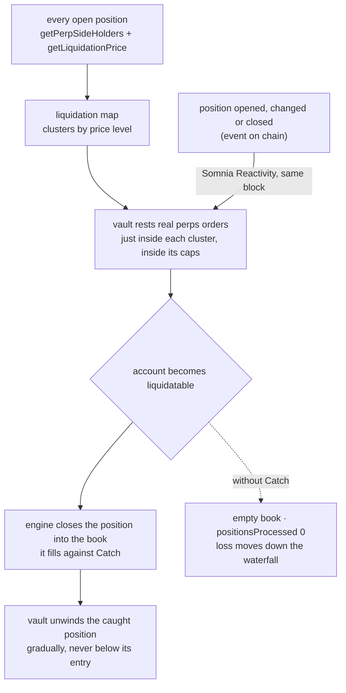

<div align="center">

# CATCH

### The liquidation backstop for dreamDEX perps. Resting liquidity where liquidations land, re-quoted by the chain.

[](#live-status)
[](#live-status)
[](#the-problem-i-set-out-to-solve)


[](#the-problem-i-set-out-to-solve) [](#the-catch-loop-step-by-step) [](#build-plan)

</div>

**Status: design stage. Nothing in this repository is built or deployed yet. Every figure below is a measurement of dreamDEX itself, not of Catch.**

On dreamDEX, a liquidation does not go to a private liquidator first. The engine cancels the account's resting orders and then closes the position **into the public order book**. Only if that fails does it reach a backstop bidder, then the insurance fund, then auto-deleveraging of profitable traders. So the order book is the first line of defence in every liquidation, and on a young venue that book is often empty. Catch is a vault whose only job is to be standing in the book at the prices where liquidations will land, re-placed by Somnia Reactivity in the same block every time a position changes.

```
liquidation price of every open position   →   resting order waiting at that level   →   the liquidation always has a buyer
```

No admin can move depositor funds, no order rests anywhere a liquidation is not expected, and no exposure is taken beyond a published cap.

## Live status

| Surface | Status | The evidence |
|---|---|---|
| Vault contract | **Not built** | design below |
| Reactivity re-quoting | **Not built** | spike 2 in the [build plan](#build-plan) |
| Liquidation map | **Not built** | reads already confirmed against the live SDK (`getPerpSideHolders`, `getLiquidationPrice`) |
| A liquidation filled into a Catch order | **Not yet** | the first proof this repository will carry, with its transaction hash |
| The problem it addresses | **Measured** | 98 of 363 liquidations on Hideki found an empty book (see below) |

## The 20-second pitch

A trader is liquidated. The engine tries to close the position into the book and finds nobody there. The account's orders are cancelled, the position stays open, and the loss moves on toward the insurance fund and, past it, toward closing out traders who were winning. Nothing broke. The book was simply empty at the one moment it was needed.

Every position on dreamDEX is public, and so is the price at which each one would be liquidated. That means the levels where forced selling will happen can be read in advance. Catch reads them, waits there with real orders, and keeps those orders where they belong without a server.



## Table of contents

- [Live status](#live-status)
- [The 20-second pitch](#the-20-second-pitch)
- [Table of contents](#table-of-contents)
- [What Catch is NOT](#what-catch-is-not)
- [The problem I set out to solve](#the-problem-i-set-out-to-solve)
- [What I am building](#what-i-am-building)
- [Architecture](#architecture)
- [The catch loop, step by step](#the-catch-loop-step-by-step)
- [Invariants](#invariants)
- [Where the guarantee is enforced](#where-the-guarantee-is-enforced)
- [Attack → test](#attack--test)
- [Risks I am designing around](#risks-i-am-designing-around)
- [What's real vs pending — the honesty table](#whats-real-vs-pending--the-honesty-table)
- [Build plan](#build-plan)
- [Tech stack](#tech-stack)
- [How the numbers were measured](#how-the-numbers-were-measured)

## What Catch is NOT

Not a liquidation guard. Guards help a trader avoid being liquidated; Catch is the buyer a liquidation sells into. Not a market maker quoting around the mid either: it places nothing near the market price and only stands where the liquidation map says forced flow will arrive. And not a keeper: Catch never triggers anyone's liquidation. It only makes sure that when the engine runs one, the book answers.

## The problem I set out to solve

Measured from the dreamDEX perps indexer on Hideki (chain 50383), covering 2026-10-20 14:55 UTC to 2026-10-22 07:10 UTC, the most recent 1,000 liquidation rows:

| | Count |
|---|---|
| Accounts liquidated | **363** |
| Liquidations that closed a position into the book (`stageReached 1`, `positionsProcessed > 0`) | 265 |
| Liquidations that found an **empty book** and closed nothing (`stageReached 1`, `positionsProcessed 0`) | **98 (27%)** |
| Positions force-closed | 264, about **4.37M USDso** notional (paper USDso) |
| Liquidations clamped at the takeover price band | 137, of which 136 on XRP |

The SDK's own documentation describes the empty-book row exactly: "Against an empty book you get `CLOBPartial` with a `positionsProcessed` of 0, which means the account's orders were cancelled and no position was closed." It also notes that with no registered backstop bidders, "the waterfall reaches ADL sooner than the configuration implies". The live LiquidationEngine reports one registered bidder, and the SDK exposes no way to register another.

Liquidity is also concentrated. Of all perps volume to date, BTC and ETH carry 65.5%, and fifteen of the twenty-one markets each carry 1.6% or less. The thinnest books are where an empty book at liquidation time is most likely.

## What I am building

- **A vault** that owns its own dreamDEX perps account. Depositors put in USDso and receive shares; the vault's margin backs its resting orders.
- **A liquidation map**: every open position's liquidation price, read from chain and clustered by level and side, per market.
- **Resting orders** placed just inside each cluster: bids under clusters of long liquidations, asks over clusters of short liquidations. They are sized from vault equity and bounded by per-market caps.
- **Re-quoting by Somnia Reactivity**: a subscription on the perps events that change positions invokes the vault in the same block, and it moves its orders to the new levels. No bot process keeps it running.
- **An unwind** that sells a caught position back out gradually and never below the price it was caught at.
- **A public page**: the live map, the vault's resting orders, every catch with its transaction, and depositor results.

## Architecture

| Component | Where it runs | What it does |
|---|---|---|
| `CatchVault` | Hideki, on chain | deposits and shares, its own MarginBank account, caps, order placement and cancellation, unwind |
| Reactivity subscription | Somnia validators | invokes the vault's handler when a position-changing event fires |
| Map reader | inside the handler and in the page | holders per side, liquidation prices, clustering |
| Page | static site | map, orders, catches, results; reads chain and indexer only |

Every write is on chain. The page and any monitoring are read-only, so turning them off changes nothing about how the vault behaves.

## The catch loop, step by step

1. **Read.** For a market, list the holders on each side and their liquidation prices.
2. **Cluster.** Group liquidation notional by price level.
3. **Place.** For each cluster inside the caps, rest a limit order a few ticks inside the level, on the side that will be forced: a bid for a long liquidation, an ask for a short one.
4. **React.** When a position opens, changes or closes, Reactivity invokes the vault in the same block. It recomputes the affected clusters and cancels or moves only the orders whose level changed.
5. **Catch.** When the engine liquidates an account at that level, the forced close fills against the vault's order.
6. **Unwind.** The vault closes what it caught with passive orders back toward the mark, never below its entry, until it is flat or the exposure cap is restored.

## Invariants

1. Per-market open exposure never exceeds its cap. An order that would breach the cap is not placed.
2. A resting order exists only where the current map has a liquidation cluster. Without a cluster, the order is cancelled.
3. A caught position is never sold below the price at which it was caught.
4. Depositors can always redeem their share. No admin path moves vault funds.
5. The vault never triggers a liquidation. It only provides liquidity to liquidations the engine runs.

## Where the guarantee is enforced

| Guarantee | Module | Test |
|---|---|---|
| Exposure cap per market | `CatchVault` | planned |
| Orders only at live clusters | `CatchVault` handler | planned |
| No unwind below catch price | `CatchVault` unwind | planned |
| Redemption always available, no admin withdrawal | `CatchVault` shares | planned |
| Same-block re-quote on position events | Reactivity subscription | planned, live on Hideki |

## Attack → test

| Attack | Intended answer | Test |
|---|---|---|
| Spoof a liquidation cluster with a large leveraged position to pull the vault's orders, then trade against them | orders are capped per market and per cluster, and placed inside the level, not at the mark | planned |
| Crash a market so the vault catches a falling position | per-market exposure cap and an unwind that never sells below entry; losses are bounded by the cap | planned |
| Starve the handler of gas so orders go stale | stale-order check on every invocation cancels anything whose cluster no longer exists | planned |
| An admin key drains the vault | no such key exists in the design; redemption is the only outflow | planned |

## Risks I am designing around

- **Catching a falling position.** A vault that buys liquidations in a crash can lose money. The exposure caps and the no-loss unwind bound it; they do not remove it.
- **Handler gas.** Perps orders are estimated at 3M to 8M gas each, and a Reactivity handler needs a generous gas limit. Re-quoting only the clusters that changed keeps each invocation small. This is the first thing to measure.
- **Subscription cost.** A subscription owner needs 32 STT at creation and pays for every invocation, so the subscription listens to position events, not to every block.

## What's real vs pending — the honesty table

| | State | Evidence |
|---|---|---|
| Liquidations close into the public book first | **Real — documented and observed** | SDK `docs/PERPS.md` stage table; live `stageReached` values |
| 27% of liquidations found an empty book | **Real — measured** | see [How the numbers were measured](#how-the-numbers-were-measured) |
| Every position and liquidation price is readable on chain | **Real — confirmed** | `getPerpSideHolders`, `getLiquidationPrice` in `@somnia-chain/markets-sdk` 0.32.1 |
| Reactivity runs on the perps chain | **Real — observed** | the perps stop registry is itself a Reactivity handler on Hideki |
| A contract-owned account resting and moving perps orders | **Pending** | spike 1 |
| Same-block re-quote from a Reactivity handler | **Pending** | spike 2 |
| A liquidation filled into a Catch order | **Pending** | spike 3 |
| Vault, map, page | **Pending** | not built |

## Build plan

1. **Spike 1.** A contract-owned dreamDEX account places, moves and cancels a resting perps order on Hideki. Output: transaction hashes.
2. **Spike 2.** A Reactivity handler, invoked by a position event, re-quotes in the same block. Output: the handler transaction and its gas.
3. **Spike 3.** A test position is pushed into liquidation and the engine's close fills against the vault's order (`positionsProcessed > 0`), next to the same run with the vault off (`positionsProcessed 0`).
4. Vault contract with shares, caps and unwind, and Foundry tests for every invariant.
5. Liquidation map reader and clustering.
6. Page: map, resting orders, catches with transactions, results.
7. A recorded live run with every transaction hash kept in `evidence/`.

If a spike fails, this file says so before anything else is built on top of it.

## Tech stack

| | |
|---|---|
| Chain | Somnia Hideki testnet (chain 50383) |
| Venue | dreamDEX perps: MarginBank, perp pools, LiquidationEngine |
| Automation | Somnia Reactivity (`@somnia-chain/reactivity`, precompile `0x0100`) |
| Contracts | Solidity, Foundry |
| Reads | `@somnia-chain/markets-sdk` 0.32.1 and the perps indexer |
| Page | static HTML and TypeScript |

## How the numbers were measured

All figures were read on 2026-10-22 with `@somnia-chain/markets-sdk` 0.32.1 against the Hideki indexer (`https://hideki-dev.smk.somnia.host/v1/graphql`), read-only, with no key:

- `client.listLiquidations({ limit: 1000 })` returned 1,000 rows from 2026-10-20 14:55 UTC to 2026-10-22 07:10 UTC: 363 `AccountLiquidated`, 264 `PositionLiquidated`, 236 `KeeperReward`, 137 `TakeoverBandClamped`.
- Of the 363 `AccountLiquidated` rows, all reached `stageReached 1`: 265 with `positionsProcessed > 0` and 98 with `positionsProcessed 0`.
- Notional is the sum over `PositionLiquidated` rows of |size| × price, scaled by each market's base decimals.
- Volume shares are each market's `cumulativeQuoteVolume` from `client.listPerpMarkets()`.

The measurement script goes into this repository with the first spike, so the figures can be re-read by anyone.
