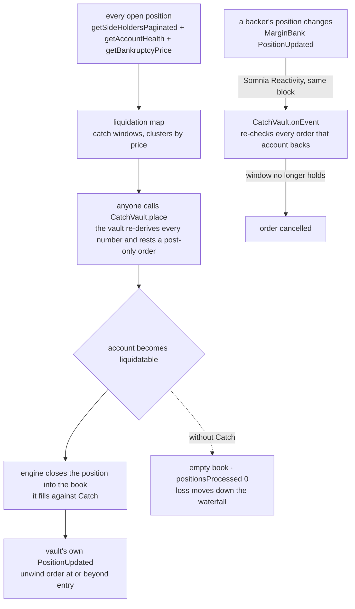

<div align="center">

# CATCH

### The liquidation backstop for dreamDEX perps. Resting liquidity where liquidations land, re-checked by the chain.

[](#live-status)
[](#live-status)
[](#invariants)
[](#the-engine)


[](https://catch-backstop.vercel.app) [](#run-it) [](#the-catch-loop-step-by-step) [](#whats-real-vs-pending)

</div>

On dreamDEX, a liquidation does not go to a private liquidator first. The engine cancels the account's resting orders and then closes the position **into the public order book**, limit-priced at most its maximum liquidation spread from the mark. Only if that fails does it reach a backstop bidder, then the insurance fund, then auto-deleveraging of profitable traders. The book is the first line of defence, and on a young venue it is often empty. Catch is a vault that stands in the book at the prices where liquidations will land, and drops each order the moment the positions behind it change.

```
every open position's liquidation price   →   a post-only order inside the engine's close window   →   the liquidation has a buyer
```

No admin can move depositor funds, no order rests where a liquidation cannot reach it, and no exposure is taken beyond a cap fixed at deploy.

## Live status

| Surface | Status | Evidence |
|---|---|---|
| `CatchVault` contract | **Built** | `contracts/src/CatchVault.sol`, 58 Foundry tests passing |
| Contract against the live venue | **Rehearsed** | constructor run against the Hideki MarginBank by `eth_call`; its catch windows for 16 real accounts are identical to the engine's, to the wei ([`deployments/rehearsal-hideki.txt`](deployments/rehearsal-hideki.txt)) |
| Liquidation map engine | **Running on live data** | reads all 21 tradeable Hideki markets from head state, about 5,900 BTC positions in one block-pinned pass |
| Dashboard | **Live** | [catch-backstop.vercel.app/app/](https://catch-backstop.vercel.app/app/), reading Hideki through Vercel functions in Tokyo, next to the Somnia RPC |
| `CatchVault` v4 on Hideki | **Live** | [`0x555fed929f625e356ef33ad37db526de20f25d54`](deployments/hideki.json), tx `0xba86a7b3b3c46952f22edc20b191f1d5d9144c793b0e160d86562f1d2539504b`; 50% market cap, 25% cluster cap |
| Cluster orders on the venue's book | **Live** | 19 post-only orders across 11 markets (BTC, ETH, BNB, SOL, HYPE, WLD and others), about $11 each, every one owned by the vault and inside its backers' catch windows |
| Reactivity | **Live, per account** | one `PositionUpdated` subscription per backing account plus the vault itself (35 at start), reconciled by the keeper every pass |
| Same-block auto-cancel | **Proven** | a test trader closed its HYPE long at tx index 2 of block 35,466,495 (`0x24e2230d…d441`); the validator-issued `onEvent` cancelled the bid it backed at tx index 16 of the same block (`0x51109d89…bb38`). Six more overnight on v2 |
| Fill → position → unwind | **Proven** | four orders on v2 filled by takers (ETH, SOL, HYPE, AVAX); each time the callback recorded the position and rested an unwind at or beyond entry in the same block, e.g. ETH short at 2,415.43 offered back at 2,324.28 (`0x91db9c26…53be`) |
| Contract refusing an order on chain | **Observed** | keeper proposals whose backers moved before the send reverted `OutsideBand(account, lo, hi, price)` |
| A liquidation filled into a Catch order | **Armed** | two test accounts hold 20x HYPE positions (long, liquidation ≈ 76.77; short, ≈ 81.61). The vault's bid and ask sit at those prices, and `liquidator.mjs` calls the venue's permissionless `liquidate()` the moment either is under maintenance. The keeper writes the fill into `deployments/hideki.json` and the dashboard's Live proofs card |

Earlier vaults stay on chain with their records: v1 (`deployments/hideki-v1.json`, venue-wide subscription, too costly), v2 (`hideki-v2.json`, found that the venue's `getOrder` reverts on a deleted order, which made re-checks revert; fixed in the contract with three regression tests), v3 (`hideki-v3.json`, caps too small for the deposit).



## Table of contents

- [Live status](#live-status)
- [What Catch is not](#what-catch-is-not)
- [The problem](#the-problem)
- [The catch loop, step by step](#the-catch-loop-step-by-step)
- [The catch window](#the-catch-window)
- [Invariants](#invariants)
- [Attack → test](#attack--test)
- [Risks](#risks)
- [The engine](#the-engine)
- [The dashboard](#the-dashboard)
- [Run it](#run-it)
- [Going live on Hideki](#going-live-on-hideki)
- [What's real vs pending](#whats-real-vs-pending)
- [Repository layout](#repository-layout)
- [How the numbers were measured](#how-the-numbers-were-measured)

## What Catch is not

Not a liquidation guard: guards help a trader avoid liquidation, Catch is the buyer a liquidation sells into. Not a market maker: it rests nothing near the mark and only stands where the map says forced flow will arrive. Not a keeper: it has no liquidation entry point and never triggers anyone's liquidation.

## The problem

From the venue's own LiquidationEngine history on Hideki:

| Window | Account liquidations | Closed into an empty book (`CLOBPartial`, `positionsProcessed 0`) |
|---|---|---|
| 2026-10-20 14:55 → 2026-10-22 07:10 UTC | 363 | **98 (27%)** |
| 2026-10-15 → 2026-10-22 (last 1,000) | 1,000 | **103 (10.3%)** |

The dashboard recomputes the second row live. On the busiest markets, the resting book inside the windows where the largest clusters would be closed is close to zero; the map page shows it per cluster.

The live LiquidationEngine reports one registered bidder and a 0.5–5% liquidation spread. With the book empty, a liquidation falls toward the insurance fund and ADL sooner than the configuration implies. Liquidity is also concentrated: BTC and ETH carry 65.5% of all perps volume to date, and fifteen of the twenty-one markets each carry 1.6% or less.

## The catch loop, step by step

1. **Read.** For a market, list every holder on each side (`getSideHoldersPaginated`), then read each position, its account health and its bankruptcy price, all pinned to one block.
2. **Map.** Solve each position's liquidation trigger (the venue's single-market solve, with the `10000 ∓ mmBps` factor) and bin liquidation notional by price.
3. **Cluster.** Sweep the catch windows and pick the price inside the most forced size, discounted by distance from the mark so a reachable cluster outranks a distant heap.
4. **Place.** Anyone calls `CatchVault.place(pool, isBid, price, qty, backers)`. The vault re-derives everything on chain: each backer's position, side and catch window, the mark, both caps. It rests a post-only order or reverts with the numbers that failed.
5. **React.** A Somnia Reactivity subscription on MarginBank `PositionUpdated` calls `CatchVault.onEvent` in the same block. Every order the changed account backs is re-checked and cancelled if its window no longer contains the price.
6. **Catch.** When the engine closes a liquidated position into the book, it fills against the vault's order.
7. **Unwind.** The vault's own `PositionUpdated` rests an unwind order at or beyond entry. Anyone may re-price it further from the mark; nobody may price it past entry.

## The catch window

The engine closes a liquidated position into the book no further than its maximum liquidation spread from the mark at trigger. An order can only catch a position if it sits in:

| Side | Window | Bound |
|---|---|---|
| Long (vault bids) | `[liq × (1 − maxSpread), liq]` | floored at the venue's bankruptcy price when it lies inside |
| Short (vault asks) | `[liq, liq × (1 + maxSpread)]` | capped at the bankruptcy price when the venue reports one above `liq` |

The short-side rule exists because the live venue reports a short's bankruptcy price at its entry, below the liquidation price. The contract ignores a bankruptcy figure on the wrong side instead of refusing every ask. `CatchVault.catchWindow(account, pool)` exposes the window; `engine/src/math.mjs` computes the same one, and the rehearsal checks they agree.

## Invariants

| # | Invariant | Enforced in | Tests |
|---|---|---|---|
| 1 | Per-market exposure ≤ `MARKET_CAP_BPS` of assets; one cluster order ≤ `CLUSTER_CAP_BPS` | `_enforceCaps` | `test_invariant1_clusterCap`, `test_invariant1_marketCap`, `test_invariant1_marketCapRevertsWithNumbers`, `testFuzz_placementNeverExceedsCaps` |
| 2 | An order rests only while every backer's catch window contains its price | `_validateCluster`, `_bandHolds`, `onEvent` | `test_invariant2_*` (7), `test_window_*` (6), `test_onEvent_survivorsStayIndexed` |
| 3 | A caught position is never offered back past its entry | `_unwind` | `test_invariant3_unwindBelowEntryReverts`, `test_invariant3_unwindShortAboveEntryReverts`, `test_catch_emitsAndRestsAnUnwindAtOrAboveEntry` |
| 4 | Redemption cancels resting orders to free collateral; no other outflow exists | `redeem`, `_releaseUntilFree` | `test_invariant4_restingOrdersAreCancelledToRedeem`, `testFuzz_roundTripNeverProfits`, `test_noAdminSurface` |
| 5 | The vault never takes liquidity | post-only orders, `CrossesMark` | `test_invariant5_neverCrossesTheMark`, `test_invariant5_postOnlyThatWouldCrossDoesNotRest` |

`cd contracts && forge test` → 58 passed.

## Attack → test

| Attack | Answer | Test |
|---|---|---|
| Open a large leveraged position to pull the vault's bid, close it, then trade into the stale order | the close emits `PositionUpdated`; the same-block callback cancels every order that account backs | `test_invariant2_backerUpdateCancelsInTheSameCallback` |
| Cite a backer whose window does not contain the price | refused, with the window in the revert data | `test_invariant2_aboveLiquidationPriceReverts`, `test_invariant2_belowBankruptcyReverts` |
| Cite the same backer twice to inflate cluster size | backers must be strictly increasing | `test_place_unsortedOrDuplicateBackersRevert` |
| Cite the vault itself as a backer | refused | `test_place_vaultCannotBackItself` |
| Fill every order slot with dust | a larger cluster evicts the smallest; an equal one is refused | `test_slots_largerClusterEvictsTheSmallest`, `test_slots_fullWithEqualSizeReverts` |
| Call the reactivity handler directly | only the precompile `0x0100` may | `test_onEvent_onlyThePrecompile` |
| Force a fire-sale of a caught position | the unwind price is bounded by entry for every caller | `test_invariant3_*` |
| Inflate shares with a donation | virtual shares and assets in the conversion | `testFuzz_roundTripNeverProfits` |
| Drain through an admin key | there is no owner and no sweep | `test_noAdminSurface` |

## Risks

- **Catching a falling position.** A vault that buys liquidations in a crash can lose money. The caps and the entry-bounded unwind limit it; they do not remove it.
- **Handler gas.** The callback re-checks only the orders the changed account backs, at most six per market, so each invocation stays bounded. Its live cost is the first thing the subscription run measures.
- **Subscription cost.** The subscription owner holds 32 STT and pays for every callback, so the subscription filters on the MarginBank emitter and the `PositionUpdated` topic, not on every block.

## The engine

`engine/` is a Node service with no framework:

| File | Role |
|---|---|
| `src/chain.mjs` | network bindings and read ABIs, transcribed from `@somnia-chain/markets-sdk` 0.32.1 |
| `src/reader.mjs` | block-pinned snapshot of one market: holders, positions, health, bankruptcy prices, via Multicall3 |
| `src/math.mjs` | liquidation solve, bins, at-risk notional, catch window, cluster sweep, order sizing |
| `src/service.mjs` | markets, maps, the venue's liquidation history, vault state and events |
| `src/server.mjs` | `/api/status`, `/api/markets`, `/api/map/:pool`, `/api/liquidations`, `/api/vault`; serves `site/` at `/` and `app/` at `/app/` |
| `scripts/live/*` | rehearse, fund, deploy, subscribe, keeper |

`npm test` checks the liquidation solve against the SDK's own `perpLiquidationPrice` and every cluster rule (12 tests).

## The dashboard

`/app/` uses the layout perps venues and vault products use: a persistent left rail, a sticky top bar with the market picker and the wallet, KPI cards, then detail.

| Page | What it shows |
|---|---|
| Overview | notional within 1% and 5% of mark across markets, book coverage inside catch windows, the empty-book rate, the BTC map, the largest clusters, the latest liquidations |
| Liquidation map | liquidation notional by trigger price with the resting book in the same bins, cumulative curves from the mark, the best bid and ask cluster with its window, size and the vault order it would produce, and the accounts closest to liquidation |
| Markets | every tradeable perp: mark, open interest, funding, positions, at-risk notional, a small map, book coverage |
| Vault | assets, share price, free and locked collateral, exposure against cap per market, resting orders, events, deposit and redeem through any EIP-1193 wallet |
| Liquidations | the venue's waterfall stage distribution, position liquidations, recent accounts |
| Contracts | every address the app reads |

Every number is read from chain or from the venue's indexer by the engine. Where the vault is not deployed, the page says so.

## Run it

```bash
git clone --recurse-submodules <this repo> && cd catch
cd contracts && forge test                      # 58 passed
cd ../engine && npm install && npm test          # 12 passed
npm start                                        # http://127.0.0.1:8787 (site) and /app/ (dashboard), live Hideki data
```

`NETWORK=shannon npm start` reads Shannon instead. Nothing above needs a key.

## Going live on Hideki

The operator key lives in `~/.catch/deployer.key` (mode 0600, outside the repo; override with `CATCH_KEY_FILE`). The scripts load it and never print it.

```bash
cd engine
npm run rehearse                        # free: constructor and catch windows against the live venue
npm run fund -- 36 20000                # Shannon: mint USDso, bridge 36 STT and 20,000 USDso to Hideki
npm run deploy -- hideki 5000 2500 30   # CatchVault(marginBank, market cap, cluster cap, unwind spread), in bps
npm run keeper -- --deposit 10000 --once # deposit, quote every market, subscribe per backing account
node scripts/live/keeper.mjs hideki --every 60          # keep quoting, re-check, record evidence
node scripts/live/liquidator.mjs hideki                 # liquidate() any backer the moment it is allowed
```

`npm run subscribe` can be rerun safely: it resumes a recorded pending transaction or recognizes an already confirmed registration instead of creating a duplicate. It records the subscription ID and confirms the owner, handler, emitter and event filter against the precompile. If the recorded registration reverted, fix the cause and run `npm run subscribe -- hideki --retry` to submit a new one.

Deployment costs about 96M gas (`eth_estimateGas` on Hideki at 6 gwei, about 0.58 STT). Every transaction lands in `deployments/hideki.json`, which the engine and the dashboard read.

## What's real vs pending

| | State | Evidence |
|---|---|---|
| Liquidations close into the public book first | **Real** | the venue's stage table; live `stageReached` values on the Liquidations page |
| A large share of liquidations found an empty book | **Measured** | the table above, recomputed live |
| Every position and its liquidation price readable from head state | **Real** | the engine maps all 21 markets |
| Contract windows match the engine on real accounts | **Rehearsed** | 16/16 identical, `deployments/rehearsal-hideki.txt` |
| Vault rules | **Tested** | 58 Foundry tests against venue doubles that follow the published ABIs, including a deleted order reverting on read |
| A contract-owned account resting orders on Hideki | **Real** | 19 orders on v4; hashes in `deployments/hideki.json` |
| Same-block cancel from a reactivity callback on Hideki | **Real** | block 35,466,495: backer closes at index 2, callback cancels at index 16 |
| Fill handled by the callback, unwind at or beyond entry | **Real** | four fills on v2, each with its callback transaction |
| A liquidation filled into a Catch order | **Armed** | orders at two test accounts' liquidation prices, permissionless `liquidate()` watcher running |
| Shannon → Hideki USDso bridge | **Blocked upstream** | the warp route's hook `0xF11C364D…77De` reverts `postDispatch` with empty data at any value; Hideki capital stays at what is already there |

A fork test was tried and dropped: neither Somnia RPC serves historical state, so neither Foundry nor anvil can fork it. The rehearsal script replaces it.

## Repository layout

```
contracts/    CatchVault, venue interfaces, tests (Foundry)
engine/       reader, map math, API server, live scripts (Node)
app/          dashboard (HTML, CSS, ES modules, no build step)
site/         landing page
deployments/  rehearsal output; per-network deployment records once live
```

## How the numbers were measured

- **27% (98 of 363):** `client.listLiquidations({ limit: 1000 })` on 2026-10-22 returned 1,000 rows from 2026-10-20 14:55 UTC to 2026-10-22 07:10 UTC, 363 of them `AccountLiquidated`; 98 had `stageReached 1` and `positionsProcessed 0`.
- **10.3% (103 of 1,000):** `client.listLiquidations({ kind: "AccountLiquidated", limit: 1000 })` with the same rule, recomputed every 20 s by `engine/src/service.mjs`.
- **65.5% BTC and ETH:** each market's `cumulativeQuoteVolume`.
- **Map figures:** `engine/scripts/snapshot.mjs` prints them for any market at the current block.
